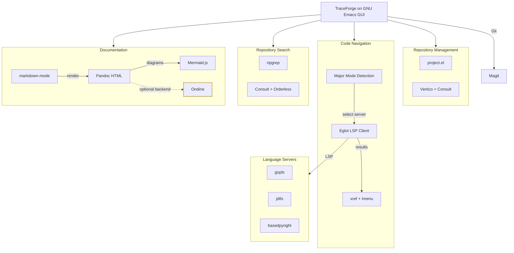
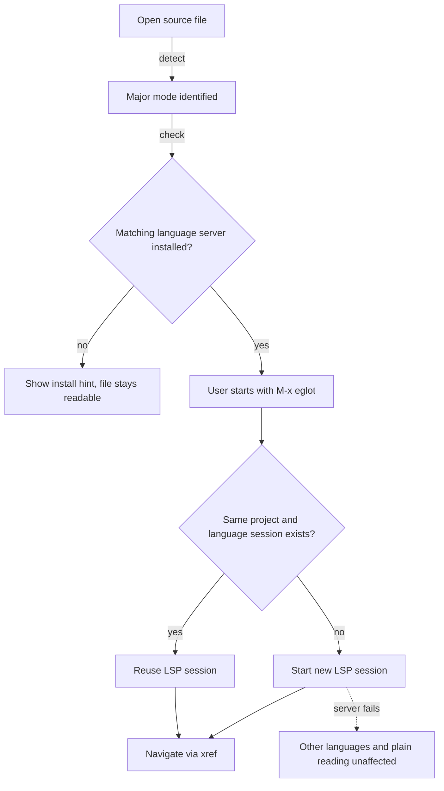
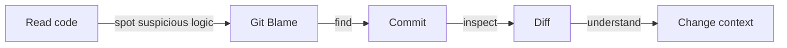
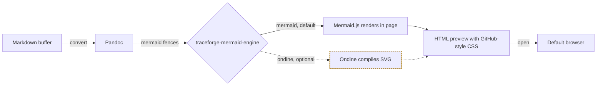

# TraceForge

**Windows 原生 GUI Emacs 程式碼瀏覽與 Repository 探索環境**

> **TraceForge — Explore Code. Trace Symbols. Understand Repositories.**

- TraceForge 是一套基於 GNU Emacs 的輕量化程式碼閱讀環境，專為 Windows 開發者設計。
- 目標不是取代 IntelliJ IDEA、GoLand 或 PyCharm，而是打造一套桌面工具：快速開啟 Repository、閱讀程式碼、追蹤 Symbol、檢視 Git 歷史，以及閱讀 Markdown 技術文件。
- **狀態：規劃中，尚無實作。** 本文件描述目標規格；文中的指令、腳本、設定變數與目錄都是規劃內容，各 Phase 的進度見 [Roadmap](#roadmap)。
- AI agent 的實作規則見 [LORE_ch.md](LORE_ch.md)（英文版 [LORE.md](LORE.md)）。

## Quick Navigation

- [專案定位](#專案定位)
- [執行平台](#執行平台)
- [系統架構](#系統架構)
- [多語言 Symbol Navigation](#多語言-symbol-navigation)
- [Java 注意事項](#java-注意事項)
- [Repository 瀏覽與搜尋](#repository-瀏覽與搜尋)
- [Git 整合](#git-整合)
- [Markdown 與 Mermaid 預覽](#markdown-與-mermaid-預覽)
- [Windows GUI 操作](#windows-gui-操作)
- [依賴](#依賴)
- [安裝與啟動](#安裝與啟動)
- [目錄結構](#目錄結構)
- [診斷](#診斷)
- [安全與相容性](#安全與相容性)
- [Roadmap](#roadmap)
- [MVP 驗收標準](#mvp-驗收標準)

## 專案定位

### 核心目標

1. 快速瀏覽本機 Git Repository。
2. 支援多種程式語言的原始碼閱讀。
3. 自動識別程式語言並連接對應的 Language Server。
4. 支援 Definition、References、Implementation 等 Symbol Navigation。
5. 提供快速的 Repository 全文搜尋。
6. 檢視 Git Commit、Diff、Blame 與檔案歷史。
7. 顯示渲染後的 Markdown 文件。
8. 支援 Markdown 中的 Mermaid Diagram。
9. 提供 Windows 原生 GUI 操作體驗。
10. 讓所有設定可透過 Git 管理、備份與還原。

### 非目標

TraceForge 不追求完整 IDE 功能。MVP 不實作：

- Debugger
- 程式編譯與部署管理
- 完整 Java Refactoring Engine
- Spring / Hibernate 專用 IDE 功能
- Database Client
- AI Coding Agent
- Email / Calendar / Org-mode
- 複雜的 GUI Framework

### 核心原則

**Read-first, Lightweight, Language-Agnostic, Windows-Native.**

### 成功標準

TraceForge 不需要擁有最多的功能。開發者在 Windows 上開啟 TraceForge、開啟 Repository 後，能夠：

**快速開啟程式碼、跨檔追蹤 Symbol、理解 Git 變更，以及閱讀完整的技術文件。**

[Back to top](#quick-navigation)

---

## 執行平台

### 支援環境

| 項目 | 規格 |
| --- | --- |
| 作業系統 | Windows 11 x64 |
| 主程式 | GNU Emacs GUI |
| Emacs 版本 | 30 以上正式版本 |
| 設定語言 | Emacs Lisp |
| 安裝腳本 | PowerShell |
| Git | Git for Windows |
| 搜尋工具 | ripgrep |
| Markdown | Pandoc |
| 預覽瀏覽器 | Microsoft Edge / Chrome |
| Language Protocol | LSP |

### 平台限制

- 必須使用 Windows 原生 GNU Emacs GUI。
- MVP 不支援：WSL / WSL2、Linux、macOS、Terminal-only Emacs、Docker-based Emacs。
- 嚴禁以 WSL 作為核心功能的替代實作。

[Back to top](#quick-navigation)

---

## 系統架構

TraceForge 在 GNU Emacs GUI 內組合成熟套件，各功能模組獨立、避免互相耦合。



- 虛線框為可選元件（Ondine，MVP 不依賴）。

[Back to top](#quick-navigation)

---

## 多語言 Symbol Navigation

這是 TraceForge 最重要的功能之一。

### 設計理念

- 採用 **Language-Agnostic Navigation** 架構：使用者不需要手動指定目前操作的是 Go、Java 或 Python。
- 系統依目前檔案的 Emacs Major Mode，判斷應使用的 Language Server。
- 無論開啟哪種語言，都使用相同的導航操作：Go to Definition、Find References、Find Implementations、Jump Back。

### Language Server 啟動流程

MVP 預設採用 **Lazy Initialization（按需啟動）**：開啟檔案不會自動連線，初次操作時可透過 `M-x eglot` 啟動。



1. 使用者開啟 Source File，Emacs 識別 Major Mode。
2. TraceForge 檢查是否存在適用的 Language Server。
3. 初次操作時可透過 `M-x eglot` 啟動。
4. 同一 Project、相同語言模式的 Buffer 儘量共用 LSP Session；不同程式語言使用各自的 Session。
5. Language Server 異常時，不影響其他語言與一般檔案閱讀。

MVP 穩定後，提供可選擇的自動啟動功能（規劃）：

```elisp
(setq traceforge-lsp-auto-start t)   ; 開啟自動啟動
(setq traceforge-lsp-auto-start nil) ; 預設值
```

- 自動啟動不會在 Emacs 啟動時立即載入所有 Language Server。

### 支援語言

MVP 支援：

| 語言 | 檔案類型 | Language Server |
| --- | --- | --- |
| Go | `.go` | gopls |
| Java | `.java` | Eclipse JDT LS |
| Python | `.py` | basedpyright |

- 未來可擴充：TypeScript / JavaScript、Rust、C / C++、C#、Kotlin。
- 新增語言時，原則上只需增加對應的 Major Mode 與 Language Server 設定。

### Eglot 與相關元件

以 Eglot 作為唯一 LSP Client，MVP 不同時引入 `lsp-mode`。

| 元件 | 職責 |
| --- | --- |
| `eglot` | LSP Session Management |
| `xref` | Definition / References |
| `imenu` | Document Symbols |
| `eldoc` | Symbol Documentation |
| `flymake` | Diagnostics |

### 多語言 Repository

- 同一個 Repository 可以包含多種程式語言，例如 `gateway/main.go` 使用 gopls、`backend/.../UserService.java` 使用 jdtls、`scripts/deploy.py` 使用 basedpyright。
- 不同 Language Server 可在相同的 Emacs GUI Session 內共存。

### Workspace Root

LSP Workspace Root 不一定等於 Git Repository Root。在 Monorepo 中，TraceForge 優先尊重 Language Server 自身與 Emacs Project API 的 Workspace Detection，避免大型 Monorepo 被重複索引。各語言常見的 Project Metadata：

| 語言 | 常見 Project Marker |
| --- | --- |
| Go | `go.mod` / `go.work` |
| Java | `pom.xml` / `build.gradle` / `settings.gradle` |
| Python | `pyproject.toml` / `setup.py` |

### 導航功能

MVP 必須支援：

| 功能 | 說明 |
| --- | --- |
| Go to Definition | 跳轉 Symbol 定義 |
| Find References | 尋找所有引用 |
| Find Implementations | 尋找介面實作 |
| Document Symbols | 搜尋目前檔案 Symbol |
| Workspace Symbols | 搜尋 Project Symbol |
| Jump Back | 返回原本位置 |
| Hover Information | 顯示 Symbol 資訊 |
| LSP Status | 顯示目前連線狀態 |

- 部分功能取決於 Language Server 是否支援；不支援時會顯示提示，不會讓整個導航功能失敗。

### 跨語言限制

- 標準 LSP 不保證支援跨語言呼叫追蹤。例如不能假設 `gopls` 可以直接找到 Go HTTP Client 呼叫的 Java REST Controller。
- 跨語言 Call Graph、API Relationship 與 Distributed Service Trace 屬於未來功能，不納入 MVP。

[Back to top](#quick-navigation)

---

## Java 注意事項

Java 使用 Eclipse JDT LS，在 Windows 上需要額外準備：

- JDK Runtime：版本需符合 jdtls 的需求。
- 啟動方式：Windows 環境不一定有可直接執行的 `jdtls.exe`；TraceForge 視需要提供專用的 PowerShell Launcher 或 Emacs Lisp 啟動設定。
- 專案匯入：支援 Maven / Gradle Project Import；Lombok 等函式庫可能需要額外設定。
- Workspace Cache：應存放在 TraceForge Runtime Directory，並依 Project 區分，多個 Java Project 互相隔離。

[Back to top](#quick-navigation)

---

## Repository 瀏覽與搜尋

### 瀏覽

採用 Emacs 內建的 `project.el`，可使用 Consult 提供互動式檔案選擇：

- 開啟本機 Repository。
- 搜尋 Project File。
- 最近使用的 Repository。
- 快速切換 Buffer。
- 分割視窗閱讀程式碼。
- 在多個 Repository 間切換。
- 支援 Windows 路徑與繁體中文路徑。

MVP 不需要完整的 Visual Project Tree。

### 搜尋

使用 ripgrep、Consult、Vertico、Orderless、Marginalia 等成熟套件，不自行實作搜尋引擎：

- Current Buffer Search。
- Repository-wide Text Search。
- File Name Search。
- Symbol Search。
- 搜尋結果跳轉。
- 遵循 `.gitignore`。
- 支援搜尋結果即時篩選。

[Back to top](#quick-navigation)

---

## Git 整合

使用 Magit，透過 Windows 原生 Git for Windows 執行，不依賴 WSL 或 Git Bash 作為啟動環境。

| 功能 | 說明 |
| --- | --- |
| Status | 查看工作目錄變更 |
| Diff | 查看新增、刪除與修改 |
| Log | 查看 Commit History |
| Blame | 追蹤每行程式碼來源 |
| Branch | 瀏覽分支 |
| Commit | 查看 Commit 詳細內容 |
| File History | 查看檔案變更歷史 |
| Revision Comparison | 比較不同版本 |

典型的追查流程：



[Back to top](#quick-navigation)

---

## Markdown 與 Mermaid 預覽

### 支援內容

TraceForge 可閱讀 Repository 中的 Markdown 文件（例如 `README.md`、`docs/architecture.md`、`docs/adr/001.md`），支援 GitHub Flavored Markdown 常用內容：

- Headings、Paragraphs、Tables、Task Lists
- Code Blocks 與 Syntax Highlighting
- Links、Images
- Mermaid Diagrams

Markdown Preview 是閱讀功能，不是完整的 Markdown 編輯平台。

### 預覽管線

MVP 以 Pandoc 產生 HTML，再交給 Windows 預設瀏覽器（Edge / Chrome）渲染，不要求安裝特殊版本的 Emacs 或 WebKit。



### 預覽指令（規劃）

`M-x traceforge-markdown-preview`：

1. 讀取目前 Markdown Buffer。
2. 產生 HTML Preview。
3. 套用基本 GitHub-style CSS。
4. 處理相對連結與圖片路徑。
5. 處理 Mermaid Code Fence。
6. 透過 Windows 預設瀏覽器顯示。
7. 儲存 Markdown 後可刷新預覽。

- MVP 不要求逐字即時同步。
- 應避免將 Repository 原始文件複製到公開伺服器。

### Emacs 內部預覽

Emacs 內部渲染是後續擴充方向，可研究 EWW、HTML-to-Text Rendering、預先編譯 Mermaid SVG 或其他 Windows GUI 相容的顯示方案。

- 必須明確區分兩種方式：在 Emacs Buffer 內顯示基本渲染內容，以及在瀏覽器顯示完整 HTML / CSS / JavaScript。
- 嚴禁假設 EWW 支援完整瀏覽器的 JavaScript Rendering。

### Mermaid

MVP 使用 Mermaid.js 將 Mermaid Code Fence 渲染為 SVG，必要支援：

- Flowchart。
- Sequence Diagram。
- 同一份文件中的多個 Diagram。
- 渲染錯誤提示。
- 離線使用已安裝的渲染資源。
- 固定依賴版本。

### Ondine（可選）

[Ondine](https://ondine.sh/)（[GitHub](https://github.com/wevm/ondine)）可將 Mermaid 語法編譯為 SVG，未來可作為可選的 Renderer Backend（規劃）：

```elisp
(setq traceforge-mermaid-engine 'mermaid) ; Mermaid.js
(setq traceforge-mermaid-engine 'ondine)  ; Ondine
```

- MVP 不強制依賴 Ondine。
- 整合前應驗證其 Windows 可用性、Mermaid 語法相容性及所需 Runtime。

[Back to top](#quick-navigation)

---

## Windows GUI 操作

TraceForge 不應要求使用者熟悉大量 Emacs 指令才能完成基本操作，應提供：

- GUI 視窗。
- 滑鼠點擊與捲動。
- 檔案開啟。
- 搜尋與跳轉。
- 基本選單與狀態提示。
- 可調整字型大小。
- 行號與語法上色。
- UTF-8 / 繁體中文支援。
- 深色與淺色 Theme。

### 快捷鍵

保留 Emacs 原生快捷鍵；其他功能優先透過命名命令與 Magit 操作。

| 操作 | 快捷鍵 |
| --- | --- |
| 開啟檔案 | `C-x C-f` |
| 儲存檔案 | `C-x C-s` |
| 執行命令 | `M-x` |
| Go to Definition | `M-.` |
| Find References | `M-?` |
| Jump Back | `M-,` |
| Project File | `C-x p f` |

### 狀態顯示

GUI 應能顯示目前的 Project、語言、Major Mode、LSP 狀態與 Git Branch，可利用 Emacs Mode Line 顯示：

```text
Project: enterprise-system
Language: Java
Major Mode: java-mode
LSP: jdtls [Connected]
Git Branch: feature/auth
```

[Back to top](#quick-navigation)

---

## 依賴

### Emacs Packages

優先使用 Emacs 內建套件；非內建套件透過 `package.el` 與 `use-package` 管理。

| Package | 用途 |
| --- | --- |
| project.el | Project Management |
| eglot | LSP Client |
| xref | Symbol Navigation |
| imenu | Document Symbols |
| magit | Git |
| consult | 搜尋與導航 |
| vertico | Completion UI |
| orderless | Completion Matching |
| marginalia | Completion Metadata |
| markdown-mode | Markdown Support |

### Windows 外部依賴

| 工具 | 用途 | 必要性 |
| --- | --- | --- |
| GNU Emacs GUI | 主程式 | 必須 |
| Git for Windows | Git 操作 | 必須 |
| ripgrep | 全文搜尋 | 必須 |
| Pandoc | Markdown HTML Rendering | 文件預覽必要 |
| Node.js LTS | Mermaid.js / Preview 工具 | 文件預覽必要 |
| Go + gopls | Go Symbol Navigation | 按需 |
| JDK + jdtls | Java Symbol Navigation | 按需 |
| basedpyright | Python Symbol Navigation | 按需 |

- Language Server 可以分別安裝；缺少某一個 Language Server（例如 jdtls）不會讓其他語言（例如 Go）的導航失效。

[Back to top](#quick-navigation)

---

## 安裝與啟動

以下腳本皆為規劃內容，尚未提供。

### 1. 安裝 GNU Emacs

- 官方下載：[GNU Emacs download](https://www.gnu.org/software/emacs/download.html)。
- Windows GUI 啟動程式通常為 `runemacs.exe`；安裝腳本應自動搜尋 Windows 原生 Emacs 路徑。

### 2. Clone Repository

使用 PowerShell：

```powershell
git clone git@github.com:Aery9527/trace-forge.git
cd trace-forge
```

### 3. 安裝 TraceForge

```powershell
.\scripts\install.ps1
```

腳本將完成：

1. 檢查 Windows 版本。
2. 檢查 Emacs GUI。
3. 檢查必要 CLI 工具。
4. 建立 Runtime Directory。
5. 準備 Emacs Package Directory。
6. 顯示可用的 Language Server。
7. 提供缺失依賴的安裝說明。

### 4. 啟動 TraceForge

```powershell
.\scripts\start.ps1
```

- 啟動後顯示 Windows 原生 Emacs GUI，不需要先開啟 WSL、Git Bash 或其他 Terminal Session。

### 設定隔離

- 安裝與啟動不會覆寫使用者既有的 Emacs 設定（`~/.emacs`、`~/.emacs.d/`）。
- TraceForge 以隔離的方式啟動 Emacs（例如 `runemacs.exe -Q` 搭配專用 Bootstrap），並自行設定 `user-emacs-directory`、`package-user-dir`、`custom-file`、Cache 與 Runtime Directory。

[Back to top](#quick-navigation)

---

## 目錄結構

### Repository（規劃）

目錄會依實際需要精簡，不預先建立沒有用途的空模組。

```text
trace-forge/
├── README.md
├── LORE.md / LORE_ch.md
├── AGENTS.md / CLAUDE.md / CODEX.md（含 _ch 版本）
├── init.el
├── early-init.el          # 僅在實際啟動機制需要時使用
├── lisp/
│   ├── traceforge-core.el
│   ├── traceforge-ui.el
│   ├── traceforge-project.el
│   ├── traceforge-navigation.el
│   ├── traceforge-lsp.el
│   ├── traceforge-search.el
│   ├── traceforge-git.el
│   └── traceforge-markdown.el
├── scripts/
│   ├── install.ps1
│   ├── start.ps1
│   └── doctor.ps1
├── preview/
│   ├── package.json
│   ├── package-lock.json
│   └── src/
├── tests/
│   ├── elisp/
│   ├── smoke/
│   └── fixtures/
│       ├── go/
│       ├── java/
│       ├── python/
│       └── markdown/
└── docs/
    ├── architecture.md
    ├── installation.md
    └── troubleshooting.md
```

### Runtime Directory（建議）

可變動資料建議放在：

```text
%LOCALAPPDATA%\TraceForge\
├── packages/
├── cache/
├── lsp/
│   └── jdtls/
├── preview/
└── state/
```

Git Repository 不儲存：

- Language Server Workspace Cache。
- Emacs 自動產生的暫存檔。
- Markdown Preview 暫存輸出。
- 使用者本機絕對路徑。
- Token、Credential 或其他機密資料。

[Back to top](#quick-navigation)

---

## 診斷

規劃提供 `.\scripts\doctor.ps1` 與 `M-x traceforge-doctor`，檢查核心依賴與 LSP 狀態。輸出範例：

```text
TraceForge Environment Check

Platform
[OK] Windows 11
[OK] Emacs GUI

Core
[OK] Git
[OK] ripgrep
[OK] Eglot
[OK] Magit

Language Servers
[OK] Go / gopls
[OK] Java / jdtls
[WARN] Python / basedpyright missing

Documentation
[OK] Pandoc
[OK] Node.js
[OK] Mermaid.js

Status: Ready
```

- 診斷結果應區分：Critical Error、Optional Dependency Missing、Language Server Missing、LSP Connection Failed、Workspace Initialization Failed。
- Language Server 不存在時，提供可讀的安裝建議。

[Back to top](#quick-navigation)

---

## 安全與相容性

以下是設計要求，實作完成前不代表已具備。

### Windows 路徑

支援含空白與繁體中文的路徑，例如：

```text
C:\Projects\My Application\
C:\Users\User\Documents\程式專案\
```

所有外部工具應支援 Windows Unicode 路徑。

### Markdown 預覽

預覽不可信任的 Repository 時，必須避免：

- 任意 JavaScript 執行。
- 不必要的外部資源載入。
- 任意本機檔案存取。
- 將 Repository 文件上傳到外部服務。

若建立本機預覽伺服器：

- 僅監聽 `127.0.0.1`。
- 使用動態可用 Port。
- 限制檔案存取範圍，防止 Path Traversal。
- 提供停止機制。
- 不公開 `.git` 或使用者機密檔案。

[Back to top](#quick-navigation)

---

## Roadmap

依 Phase 1 至 Phase 6 順序實作；Phase 7 不阻塞 MVP。每個 Phase 完成時更新本表的狀態，並記錄未完成與未驗證項目。

| Phase | 目標 | 交付 | 狀態 |
| --- | --- | --- | --- |
| 1. Windows GUI Bootstrap | 在 Windows 原生啟動 TraceForge | Emacs 基礎設定、PowerShell Install / Start Scripts、設定隔離、UTF-8 / 繁體中文顯示、基本 GUI | 規劃中 |
| 2. Repository Explorer | 快速瀏覽 Repository | project.el、Vertico / Consult、File Navigation、Repository Search、ripgrep Integration | 規劃中 |
| 3. Multi-Language Navigation | Go / Java / Python 使用相同的 Symbol Navigation | Eglot Integration、Major Mode Detection、LSP Server Mapping、Workspace Root Detection、Lazy Initialization、Definition / References / Implementations、LSP Status | 規劃中 |
| 4. Git Integration | 不離開 Emacs 查看 Git 歷史 | Magit、Status / Diff / Log、Blame、File History | 規劃中 |
| 5. Markdown Preview | 直接從 Emacs 開啟渲染後的 Markdown | markdown-mode、Pandoc、HTML Preview、Windows Browser Integration、圖片與相對連結處理 | 規劃中 |
| 6. Mermaid Rendering | 正常閱讀架構文件中的 Mermaid Diagram | Mermaid.js Integration、Flowchart / Sequence Diagram、Offline Rendering Assets、錯誤處理 | 規劃中 |
| 7. Ondine Evaluation | 評估是否加入 Ondine SVG Compiler | Windows Compatibility Investigation、Mermaid.js / Ondine Comparison、可選 Backend 設計 | 規劃中 |

### 優先級

- **P0 — 必須完成：** Windows GUI Bootstrap、Repository Navigation、Go / Java / Python Symbol Navigation、Repository Search、Magit、Markdown Preview、Mermaid.js Rendering。
- **P1 — 建議完成：** LSP 自動啟動選項、詳細的 LSP Status、Project-specific Language Server Settings、Preview Auto Refresh、更完善的 Windows Diagnostics。
- **P2 — 未來擴充：** Ondine Integration、Emacs 內嵌完整 Markdown Preview、Call Hierarchy Visualization、Cross-language Symbol Graph、GitHub Pull Request Browsing、AI-assisted Code Explanation。

[Back to top](#quick-navigation)

---

## MVP 驗收標準

| 項目 | 預期結果 |
| --- | --- |
| Windows GUI | 可正常啟動 |
| 設定隔離 | 不修改既有 Emacs 設定 |
| Repository | 可開啟本機 Git Repository |
| Go Symbol | 可跳轉 Definition / References |
| Java Symbol | 可跳轉 Definition / References |
| Python Symbol | 可跳轉 Definition / References |
| 多語言切換 | 不需手動修改 LSP 設定 |
| 同時開啟 | 多個 Language Server 可共存 |
| Workspace Root | Monorepo 能正確識別專案範圍 |
| LSP Error | 單一語言錯誤不影響其他語言 |
| Repository Search | 可透過 ripgrep 搜尋 |
| Git | 可使用 Magit 查看 Log / Diff / Blame |
| Markdown | 可顯示渲染後的文件 |
| Mermaid | 可顯示 Flowchart / Sequence Diagram |
| Windows 路徑 | 支援中文與空白 |
| Doctor | 可檢查核心依賴與 LSP 狀態 |

- 必須使用實際 Windows 原生環境驗證。
- Emacs Batch Mode 可以作為自動化測試，但嚴禁取代 GUI Smoke Test。

[Back to top](#quick-navigation)
