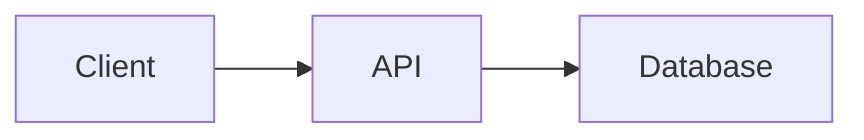

# TraceForge

**Windows 原生 GUI Emacs 程式碼瀏覽與 Repository 探索環境**

TraceForge 是一套基於 GNU Emacs 的輕量化程式碼閱讀環境，專為 Windows 開發者設計。

本專案的目標不是取代 IntelliJ IDEA、GoLand 或 PyCharm，而是打造一套可以快速開啟 Repository、閱讀程式碼、追蹤 Symbol、檢視 Git 歷史，以及閱讀 Markdown 技術文件的桌面工具。

> **TraceForge — Explore Code. Trace Symbols. Understand Repositories.**

---

## 1. 專案定位

### 1.1 核心目標

TraceForge 專注於以下需求：

1. 快速瀏覽本機 Git Repository。
2. 支援多種程式語言的原始碼閱讀。
3. 自動識別程式語言並連接對應的 Language Server。
4. 支援 Definition、References、Implementation 等 Symbol Navigation。
5. 提供快速的 Repository 全文搜尋。
6. 檢視 Git Commit、Diff、Blame 與檔案歷史。
7. 顯示渲染後的 Markdown 文件。
8. 支援 Markdown 中的 Mermaid Diagram。
9. 提供 Windows 原生 GUI 操作體驗。
10. 讓所有設定可透過 Git 管理、備份與還原。

### 1.2 非目標

TraceForge 不追求完整 IDE 功能。

MVP 不實作：

- Debugger
- 程式編譯與部署管理
- 完整 Java Refactoring Engine
- Spring / Hibernate 專用 IDE 功能
- Database Client
- AI Coding Agent
- Email / Calendar / Org-mode
- 複雜的 GUI Framework

核心原則：

**Read-first, Lightweight, Language-Agnostic, Windows-Native.**

---

## 2. 執行平台

### 2.1 支援環境

| 項目 | 規格 |
|---|---|
| 作業系統 | Windows 11 x64 |
| 主程式 | GNU Emacs GUI |
| Emacs 版本 | 30 以上正式版本 |
| 設定語言 | Emacs Lisp |
| 安裝腳本 | PowerShell |
| Git | Git for Windows |
| 搜尋工具 | ripgrep |
| Markdown | Pandoc |
| 預覽瀏覽器 | Microsoft Edge / Chrome |
| Language Protocol | LSP |

### 2.2 平台限制

MVP 不支援：

- WSL / WSL2
- Linux
- macOS
- Terminal-only Emacs
- Docker-based Emacs

必須使用 Windows 原生 GNU Emacs GUI。

不允許將 WSL 作為核心功能的替代實作。

---

## 3. 系統架構

```text
Windows 11
│
└── TraceForge
    │
    └── GNU Emacs GUI
        │
        ├── Repository Management
        │   ├── project.el
        │   ├── Consult
        │   └── Vertico
        │
        ├── Code Navigation
        │   ├── Major Mode Detection
        │   ├── Eglot (LSP Client)
        │   ├── xref
        │   └── Imenu
        │       │
        │       ├── Go → gopls
        │       ├── Java → jdtls
        │       └── Python → basedpyright
        │
        ├── Repository Search
        │   ├── ripgrep
        │   ├── Consult
        │   └── Orderless
        │
        ├── Git Integration
        │   └── Magit
        │       ├── Status
        │       ├── Log
        │       ├── Diff
        │       └── Blame
        │
        └── Documentation
            ├── markdown-mode
            ├── Pandoc
            ├── HTML Preview
            └── Mermaid Renderer
                ├── Mermaid.js
                └── Ondine (Optional)
```

所有 Emacs 功能應採模組化實作，避免互相耦合。

---

## 4. 多語言 Symbol Navigation

這是 TraceForge 最重要的功能之一。

### 4.1 設計理念

TraceForge 採用 **Language-Agnostic Navigation** 架構。

使用者不需要手動指定目前操作的是 Go、Java 或 Python。

系統根據目前檔案的 Emacs Major Mode，自動判斷應使用的 Language Server。

例如：

```text
開啟 Source File
        │
        ▼
Emacs Major Mode Detection
        │
        ▼
Eglot (LSP Client)
        │
        ├── .go
        │    └── gopls
        │
        ├── .java
        │    └── jdtls
        │
        └── .py
             └── basedpyright
        │
        ▼
     xref API
        │
        ├── Go to Definition
        ├── Find References
        ├── Find Implementations
        └── Jump Back
```

無論開啟哪種語言，使用者都應使用相同的導航操作。

### 4.2 支援語言

MVP 支援：

| 語言 | 檔案類型 | Language Server |
|---|---|---|
| Go | `.go` | gopls |
| Java | `.java` | Eclipse JDT LS |
| Python | `.py` | basedpyright |

未來可擴充：

- TypeScript / JavaScript
- Rust
- C / C++
- C#
- Kotlin

新增語言時，原則上只需增加對應的 Major Mode 與 Language Server 設定，不應修改核心 Navigation API。

### 4.3 Eglot Integration

以 Emacs 內建或相容版本的 Eglot 作為唯一 LSP Client。

不在 MVP 同時引入 `lsp-mode`。

採用：

- `eglot`：LSP Session Management。
- `xref`：Definition / References。
- `imenu`：Document Symbols。
- `eldoc`：Symbol Documentation。
- `flymake`：Diagnostics。

優先使用 Eglot 已提供的預設 Language Server Mapping。

只有在預設設定不足時，才修改 `eglot-server-programs`。

### 4.4 Language Server Lifecycle

MVP 預設採用 **Lazy Initialization（按需啟動）**。

行為：

1. 使用者開啟 Source File。
2. Emacs 識別 Major Mode。
3. TraceForge 檢查是否存在適用的 Language Server。
4. 初次操作時可透過 `M-x eglot` 啟動。
5. 同一 Project、相同語言模式的 Buffer 儘量共用 LSP Session。
6. 切換不同程式語言時，使用各自的 LSP Session。
7. Language Server 異常時，不影響其他語言與一般檔案閱讀。

MVP 穩定後，提供可選擇的自動啟動功能：

```elisp
(setq traceforge-lsp-auto-start t)
```

預設值：

```elisp
(setq traceforge-lsp-auto-start nil)
```

自動啟動功能不得造成 Emacs 啟動時立即載入所有 Language Server。

### 4.5 多語言 Repository

必須支援同一個 Repository 內包含多種程式語言。

例如：

```text
enterprise-system/
│
├── gateway/
│   ├── go.mod
│   └── main.go
│
├── backend/
│   ├── pom.xml
│   └── src/main/java/
│       └── UserService.java
│
├── scripts/
│   └── deploy.py
│
└── docs/
    └── architecture.md
```

預期行為：

```text
gateway/main.go
      ↓
Eglot → gopls

backend/UserService.java
      ↓
Eglot → jdtls

scripts/deploy.py
      ↓
Eglot → basedpyright
```

不同 Language Server 應可在相同 Emacs GUI Session 內共存。

### 4.6 Workspace Root Detection

不能假設 Git Repository Root 永遠等於 LSP Workspace Root。

例如：

```text
monorepo/
├── service-a/
│   └── go.mod
├── service-b/
│   └── pom.xml
└── service-c/
    └── pyproject.toml
```

系統應考慮不同語言的 Project Metadata：

| 語言 | 常見 Project Marker |
|---|---|
| Go | `go.mod` / `go.work` |
| Java | `pom.xml` / `build.gradle` / `settings.gradle` |
| Python | `pyproject.toml` / `setup.py` |

不應單純將所有檔案強制指向最上層 Git Root。

實作時應優先尊重 Language Server 自己的 Workspace Detection 與 Emacs Project API，必要時才加入可覆寫的 Root Resolver。

必須避免因為不正確的 Root Detection，導致大型 Monorepo 被重複索引。

### 4.7 Java 特殊處理

Java Language Server 採用 Eclipse JDT LS。

Windows 版本需考慮：

- JDK Runtime 版本需求。
- jdtls 啟動參數。
- Windows 專用 Configuration。
- Maven / Gradle Project Import。
- Workspace Cache。
- 多個 Java Project 的隔離。
- Lombok 等額外相依設定。

不得假設所有 Windows 環境都有可直接執行的 `jdtls.exe`。

如有必要，應建立專用的 PowerShell Launcher 或 Emacs Lisp 啟動設定。

JDT LS Workspace Cache 應存放在 TraceForge Runtime Directory，並依 Project 區分。

### 4.8 Symbol Navigation 功能

MVP 必須支援：

| 功能 | 說明 |
|---|---|
| Go to Definition | 跳轉 Symbol 定義 |
| Find References | 尋找所有引用 |
| Find Implementations | 尋找介面實作 |
| Document Symbols | 搜尋目前檔案 Symbol |
| Workspace Symbols | 搜尋 Project Symbol |
| Jump Back | 返回原本位置 |
| Hover Information | 顯示 Symbol 資訊 |
| LSP Status | 顯示目前連線狀態 |

部分功能取決於 Language Server 是否支援。

如果 Language Server 不支援特定功能，應提供合理的提示，而不是讓整個導航功能失敗。

### 4.9 跨語言限制

標準 LSP 不保證支援跨語言呼叫追蹤。

例如：

```text
Go HTTP Client
       │
       ▼
Java REST Controller
       │
       ▼
Database
```

不能假設 `gopls` 可以直接找到 HTTP Request 對應的 Java Controller。

跨語言 Call Graph、API Relationship 與 Distributed Service Trace 屬於未來功能，不納入 MVP。

---

## 5. Repository 瀏覽

採用 Emacs 內建的 `project.el`。

必要功能：

- 開啟本機 Repository。
- 搜尋 Project File。
- 最近使用的 Repository。
- 快速切換 Buffer。
- 分割視窗閱讀程式碼。
- 在多個 Repository 間切換。
- 支援 Windows 路徑與繁體中文路徑。

可使用 Consult 提供互動式檔案選擇。

不需要在 MVP 建立完整的 Visual Project Tree。

---

## 6. Repository Search

使用：

- ripgrep
- Consult
- Vertico
- Orderless
- Marginalia

必要功能：

- Current Buffer Search。
- Repository-wide Text Search。
- File Name Search。
- Symbol Search。
- 搜尋結果跳轉。
- 遵循 `.gitignore`。
- 支援搜尋結果即時篩選。

設計應優先使用成熟 Package，不自行實作新的搜尋引擎。

---

## 7. Git Integration

使用 Magit。

### 7.1 功能需求

| 功能 | 說明 |
|---|---|
| Status | 查看工作目錄變更 |
| Diff | 查看新增、刪除與修改 |
| Log | 查看 Commit History |
| Blame | 追蹤每行程式碼來源 |
| Branch | 瀏覽分支 |
| Commit | 查看 Commit 詳細內容 |
| File History | 查看檔案變更歷史 |
| Revision Comparison | 比較不同版本 |

### 7.2 典型流程

```text
閱讀程式碼
    │
    ▼
發現可疑邏輯
    │
    ▼
Git Blame
    │
    ▼
找到 Commit
    │
    ▼
檢查 Diff
    │
    ▼
理解修改背景
```

Git 必須能透過 Windows 原生 Git for Windows 執行。

不依賴 WSL 或 Git Bash 作為啟動環境。

---

## 8. Markdown 文件閱讀

### 8.1 需求

TraceForge 必須能閱讀 Repository 中的 Markdown 文件。

例如：

```text
README.md
docs/architecture.md
docs/design.md
docs/adr/001.md
```

支援 GitHub Flavored Markdown 常用內容：

- Headings
- Paragraphs
- Tables
- Task Lists
- Code Blocks
- Syntax Highlighting
- Links
- Images
- Mermaid Diagrams

Markdown Preview 是閱讀功能，不是完整的 Markdown 編輯平台。

### 8.2 預覽架構

MVP 採用：

```text
Emacs GUI
    │
    ▼
Markdown Buffer
    │
    ▼
Pandoc
    │
    ▼
HTML Generator
    │
    ▼
Browser Preview
    │
    └── Edge / Chrome
```

優先使用 Windows 預設瀏覽器完成高品質渲染。

不要求使用者安裝特殊版本的 Emacs 或 WebKit。

### 8.3 預覽功能

提供指令：

```text
M-x traceforge-markdown-preview
```

必要行為：

1. 讀取目前 Markdown Buffer。
2. 產生 HTML Preview。
3. 套用基本 GitHub-style CSS。
4. 處理相對連結與圖片路徑。
5. 處理 Mermaid Code Fence。
6. 透過 Windows 預設瀏覽器顯示。
7. 儲存 Markdown 後可刷新預覽。

MVP 不要求逐字即時同步。

應避免將 Repository 原始文件複製到公開伺服器。

### 8.4 Emacs 內部預覽

Emacs 內部渲染是後續擴充方向。

可研究：

- EWW
- HTML-to-Text Rendering
- 預先編譯 Mermaid SVG
- 其他 Windows GUI 相容的顯示方案

必須明確區分：

- 在 Emacs Buffer 內顯示基本渲染內容。
- 在瀏覽器顯示完整 HTML / CSS / JavaScript。

不得假設 EWW 支援完整瀏覽器的 JavaScript Rendering。

---

## 9. Mermaid Rendering

### 9.1 基本需求

Markdown 可能包含：

````markdown

````

TraceForge 應將 Mermaid Code Fence 渲染成圖形。

### 9.2 Mermaid.js

MVP 使用 Mermaid.js。

流程：

```text
Markdown
   │
   ▼
Pandoc / HTML Pipeline
   │
   ▼
Mermaid Code Block
   │
   ▼
Mermaid.js
   │
   ▼
SVG Diagram
```

必要支援：

- Flowchart。
- Sequence Diagram。
- 同一份文件中的多個 Diagram。
- 渲染錯誤提示。
- 離線使用已安裝的渲染資源。
- 固定依賴版本。

### 9.3 Ondine Integration

官方網站：

https://ondine.sh/

GitHub：

https://github.com/wevm/ondine

Ondine 可將 Mermaid 語法編譯為 SVG。

未來可實作：

```text
Markdown
   │
   ▼
Mermaid Code Fence
   │
   ▼
Ondine Compiler
   │
   ▼
SVG
   │
   ▼
HTML Preview
```

預期提供：

```elisp
(setq traceforge-mermaid-engine 'mermaid)
```

或：

```elisp
(setq traceforge-mermaid-engine 'ondine)
```

Ondine 必須是可選的 Renderer Backend。

MVP 不強制依賴 Ondine。

整合前應驗證其 Windows 可用性、Mermaid 語法相容性及所需 Runtime。

---

## 10. Windows GUI 操作體驗

TraceForge 不應要求使用者熟悉大量 Emacs 指令才能完成基本操作。

應提供：

- GUI 視窗。
- 滑鼠點擊與捲動。
- 檔案開啟。
- 搜尋與跳轉。
- 基本選單與狀態提示。
- 可調整字型大小。
- 行號與語法上色。
- UTF-8 / 繁體中文支援。
- 深色與淺色 Theme。

### 10.1 快捷鍵

保留 Emacs 原生快捷鍵。

| 操作 | 快捷鍵 |
|---|---|
| 開啟檔案 | `C-x C-f` |
| 儲存檔案 | `C-x C-s` |
| 執行命令 | `M-x` |
| Go to Definition | `M-.` |
| Find References | `M-?` |
| Jump Back | `M-,` |
| Project File | `C-x p f` |

其他功能優先透過命名命令與 Magit 操作，不過度修改原生 Keymap。

### 10.2 狀態顯示

GUI 應能識別：

```text
Project: enterprise-system
Language: Java
Major Mode: java-mode
LSP: jdtls [Connected]
Git Branch: feature/auth
```

實作時可利用 Emacs Mode Line 顯示資訊，不需要建立自訂 Status Bar Framework。

---

## 11. 核心依賴

### 11.1 Emacs Packages

| Package | 用途 |
|---|---|
| project.el | Project Management |
| eglot | LSP Client |
| xref | Symbol Navigation |
| imenu | Document Symbols |
| magit | Git |
| consult | 搜尋與導航 |
| vertico | Completion UI |
| orderless | Completion Matching |
| marginalia | Completion Metadata |
| markdown-mode | Markdown Support |

優先使用 Emacs 內建套件。

非內建套件透過 `package.el` 與 `use-package` 管理。

### 11.2 Windows 外部依賴

| 工具 | 用途 | 必要性 |
|---|---|---|
| GNU Emacs GUI | 主程式 | 必須 |
| Git for Windows | Git 操作 | 必須 |
| ripgrep | 全文搜尋 | 必須 |
| Pandoc | Markdown HTML Rendering | 文件預覽必要 |
| Node.js LTS | Mermaid.js / Preview 工具 | 文件預覽必要 |
| Go + gopls | Go Symbol Navigation | 按需 |
| JDK + jdtls | Java Symbol Navigation | 按需 |
| basedpyright | Python Symbol Navigation | 按需 |

Language Server 必須可以分別安裝。

不得因為缺少 Java Language Server 而導致 Go 導航無法使用。

---

## 12. 安裝方式

### 12.1 GNU Emacs

官方下載：

https://www.gnu.org/software/emacs/download.html

Windows GUI 啟動程式通常為：

```text
runemacs.exe
```

TraceForge 安裝腳本應自動搜尋 Windows 原生 Emacs 路徑。

### 12.2 Clone Repository

使用 PowerShell：

```powershell
git clone <repository-url>

cd traceforge
```

### 12.3 安裝 TraceForge

預期提供：

```powershell
.\scripts\install.ps1
```

腳本需完成：

1. 檢查 Windows 版本。
2. 檢查 Emacs GUI。
3. 檢查必要 CLI 工具。
4. 建立 Runtime Directory。
5. 準備 Emacs Package Directory。
6. 顯示可用的 Language Server。
7. 提供缺失依賴的安裝說明。

安裝不應直接覆寫使用者現有的 Emacs 設定。

### 12.4 啟動 TraceForge

提供：

```powershell
.\scripts\start.ps1
```

啟動後應顯示 Windows 原生 Emacs GUI。

不需要先開啟 WSL、Git Bash 或其他 Terminal Session 才能使用圖形介面。

### 12.5 設定隔離

必須避免覆寫：

```text
~/.emacs
~/.emacs.d/
```

建議採用隔離的 Emacs 啟動方式，例如由 `runemacs.exe` 使用 `-Q` 搭配專用 Bootstrap，明確載入 TraceForge 設定。

初始化流程需正確設定：

- `user-emacs-directory`
- `package-user-dir`
- `custom-file`
- Cache Directory
- Runtime Directory

不能單純假設 `--init-directory` 一定能避開所有既有 Emacs 初始化檔案。

---

## 13. Repository 結構

```text
traceforge/
│
├── README.md
├── AGENTS.md
├── .gitignore
│
├── init.el
├── early-init.el
│
├── lisp/
│   ├── traceforge-core.el
│   ├── traceforge-ui.el
│   ├── traceforge-project.el
│   ├── traceforge-navigation.el
│   ├── traceforge-lsp.el
│   ├── traceforge-search.el
│   ├── traceforge-git.el
│   └── traceforge-markdown.el
│
├── scripts/
│   ├── install.ps1
│   ├── start.ps1
│   └── doctor.ps1
│
├── preview/
│   ├── package.json
│   ├── package-lock.json
│   └── src/
│
├── tests/
│   ├── elisp/
│   ├── smoke/
│   └── fixtures/
│       ├── go/
│       ├── java/
│       ├── python/
│       └── markdown/
│
└── docs/
    ├── architecture.md
    ├── installation.md
    └── troubleshooting.md
```

`early-init.el` 僅在實際啟動機制需要時使用；不可假設由 `-Q` 載入 Bootstrap 後會自動處理它。

目錄允許依實際情況精簡，避免初期產生大量沒有實際用途的空模組。

---

## 14. Runtime Directory

建議將可變動資料放在：

```text
%LOCALAPPDATA%\TraceForge\
│
├── packages/
├── cache/
├── lsp/
│   └── jdtls/
├── preview/
└── state/
```

Git Repository 不儲存：

- Language Server Workspace Cache。
- Emacs 自動產生的暫存檔。
- Markdown Preview 暫存輸出。
- 使用者本機絕對路徑。
- Token、Credential 或其他機密資料。

所有外部工具應支援 Windows Unicode 路徑。

---

## 15. 診斷功能

提供：

```powershell
.\scripts\doctor.ps1
```

以及：

```text
M-x traceforge-doctor
```

診斷輸出範例：

```text
TraceForge Environment Check

Platform
[OK] Windows 11
[OK] Emacs GUI

Core
[OK] Git
[OK] ripgrep
[OK] Eglot
[OK] Magit

Language Servers
[OK] Go / gopls
[OK] Java / jdtls
[WARN] Python / basedpyright missing

Documentation
[OK] Pandoc
[OK] Node.js
[OK] Mermaid.js

Status: Ready
```

應區分：

- Critical Error
- Optional Dependency Missing
- Language Server Missing
- LSP Connection Failed
- Workspace Initialization Failed

當 Language Server 不存在時，必須提供可讀取的安裝建議。

---

## 16. 安全與相容性

### 16.1 Windows 路徑

應支援：

```text
C:\Projects\My Application\
C:\Users\User\Documents\程式專案\
```

需測試：

- 空白路徑。
- Unicode / 繁體中文。
- Windows 路徑分隔字元。
- 大小寫處理。
- 可執行檔與 `.cmd` Launcher。
- PowerShell Argument Quoting。

### 16.2 外部程式執行

不得直接將未清理的使用者輸入拼接為 Shell Command。

應優先使用 Emacs Process API 或 PowerShell 的安全參數傳遞方式。

### 16.3 Markdown Preview 安全性

預覽不可信任 Repository 時，必須避免：

- 任意 JavaScript 執行。
- 不必要的外部資源載入。
- 任意本機檔案存取。
- 將 Repository 文件上傳到外部服務。

若建立 Local Preview Server：

- 僅監聽 `127.0.0.1`。
- 使用動態可用 Port。
- 限制檔案存取範圍。
- 防止 Path Traversal。
- 提供停止機制。
- 不公開 `.git` 或使用者機密檔案。

---

## 17. 開發 Roadmap

### Phase 1 — Windows GUI Bootstrap

目標：可以在 Windows 原生啟動 TraceForge。

交付：

- Emacs 基礎設定。
- PowerShell Install / Start Scripts。
- 設定隔離。
- UTF-8 / 繁體中文顯示。
- 基本 GUI。

### Phase 2 — Repository Explorer

目標：可以快速瀏覽 Repository。

交付：

- project.el。
- Vertico / Consult。
- File Navigation。
- Repository Search。
- ripgrep Integration。

### Phase 3 — Multi-Language Navigation

目標：Go / Java / Python 可使用相同的 Symbol Navigation。

交付：

- Eglot Integration。
- Major Mode Detection。
- LSP Server Mapping。
- Workspace Root Detection。
- Lazy Initialization。
- Definition / References / Implementations。
- LSP Status。

### Phase 4 — Git Integration

目標：可以不離開 Emacs 查看 Git 歷史。

交付：

- Magit。
- Status / Diff / Log。
- Blame。
- File History。

### Phase 5 — Markdown Preview

目標：可以直接從 Emacs 開啟渲染後的 Markdown。

交付：

- markdown-mode。
- Pandoc。
- HTML Preview。
- Windows Browser Integration。
- 圖片與相對連結處理。

### Phase 6 — Mermaid Rendering

目標：可以正常閱讀架構文件中的 Mermaid Diagram。

交付：

- Mermaid.js Integration。
- Flowchart / Sequence Diagram。
- Offline Rendering Assets。
- 錯誤處理。

### Phase 7 — Ondine Evaluation

目標：評估是否加入 Ondine SVG Compiler。

交付：

- Windows Compatibility Investigation。
- Mermaid.js / Ondine Comparison。
- 可選 Backend 設計。

Phase 7 不阻塞 MVP。

---

## 18. MVP 驗收標準

| 項目 | 預期結果 |
|---|---|
| Windows GUI | 可正常啟動 |
| 設定隔離 | 不修改既有 Emacs 設定 |
| Repository | 可開啟本機 Git Repository |
| Go Symbol | 可跳轉 Definition / References |
| Java Symbol | 可跳轉 Definition / References |
| Python Symbol | 可跳轉 Definition / References |
| 多語言切換 | 不需手動修改 LSP 設定 |
| 同時開啟 | 多個 Language Server 可共存 |
| Workspace Root | Monorepo 能正確識別專案範圍 |
| LSP Error | 單一語言錯誤不影響其他語言 |
| Repository Search | 可透過 ripgrep 搜尋 |
| Git | 可使用 Magit 查看 Log / Diff / Blame |
| Markdown | 可顯示渲染後的文件 |
| Mermaid | 可顯示 Flowchart / Sequence Diagram |
| Windows 路徑 | 支援中文與空白 |
| Doctor | 可檢查核心依賴與 LSP 狀態 |

必須使用實際 Windows 原生環境驗證。

Emacs Batch Mode 可以作為自動化測試，但不能取代 GUI Smoke Test。

---

## 19. Codex 實作規範

本 Repository 將由 Codex 協助開發。

### 19.1 執行原則

1. 閱讀本 README，理解專案範圍。
2. 僅針對 Windows Native GUI Emacs 設計。
3. 優先使用 Emacs 內建 API。
4. 不自行重寫成熟的 Emacs Package。
5. 不引入不必要的 Framework。
6. 保持各個功能模組獨立。
7. 正確處理多語言 LSP。
8. 所有外部依賴都需記錄安裝方式。
9. 保持使用者環境與 Git Repository 隔離。
10. 每個 Phase 都應有可執行的驗收方式。

### 19.2 開發順序

Codex 應依照 Phase 1 至 Phase 6 順序實作。

每個階段完成時，需：

- 驗證 Emacs 設定可以載入。
- 執行適用的自動化測試。
- 更新 README 或相關文件。
- 記錄未完成與未驗證項目。
- 將可驗收功能獨立提交 Commit。

不得因為無法在當前環境進行 Windows GUI 測試，就宣稱該項目已通過完整驗收。

### 19.3 Git Commit Convention

建議：

```text
feat: bootstrap Windows Emacs environment
feat: add repository navigation
feat: integrate multi-language eglot support
feat: add workspace root detection
feat: add Magit integration
feat: implement Markdown preview
feat: support Mermaid rendering
test: add Windows GUI smoke tests
docs: update installation guide
```

### 19.4 開發優先級

**P0 — 必須完成**

- Windows GUI Bootstrap
- Repository Navigation
- Go / Java / Python Symbol Navigation
- Repository Search
- Magit
- Markdown Preview
- Mermaid.js Rendering

**P1 — 建議完成**

- LSP 自動啟動選項
- 詳細的 LSP Status
- Project-specific Language Server Settings
- Preview Auto Refresh
- 更完善的 Windows Diagnostics

**P2 — 未來擴充**

- Ondine Integration
- Emacs 內嵌完整 Markdown Preview
- Call Hierarchy Visualization
- Cross-language Symbol Graph
- GitHub Pull Request Browsing
- AI-assisted Code Explanation

---

## 20. 最終使用情境

開發者在 Windows 上開啟 TraceForge：

```text
Windows Desktop
       │
       ▼
TraceForge (Emacs GUI)
       │
       ▼
Open Repository
       │
       ├── Code Reading
       │    │
       │    ├── Java
       │    │    └── jdtls
       │    │
       │    ├── Go
       │    │    └── gopls
       │    │
       │    └── Python
       │         └── basedpyright
       │
       ├── Symbol Navigation
       │    ├── Definition
       │    ├── References
       │    └── Implementations
       │
       ├── Repository Search
       │    └── ripgrep
       │
       ├── Git Explorer
       │    ├── Log
       │    ├── Diff
       │    └── Blame
       │
       └── Documentation
            ├── Markdown
            └── Mermaid
```

### 成功標準

TraceForge 不需要擁有最多的功能。

它只需要讓開發者能夠：

**快速開啟程式碼、跨檔追蹤 Symbol、理解 Git 變更，以及閱讀完整的技術文件。**

這就是 TraceForge 的核心價值。